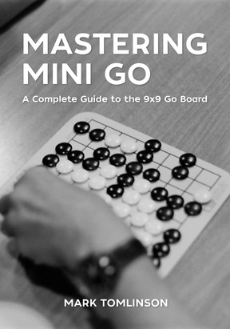
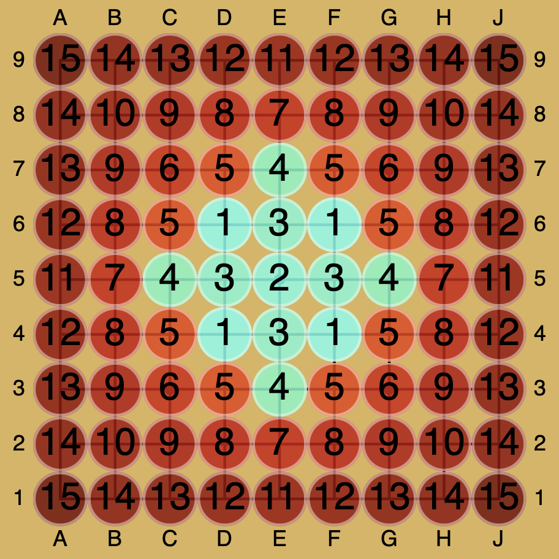
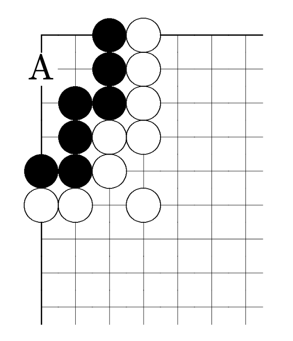

### Reviewing ‹Mastering Mini Go› by Mark Tomlinson

“The 9×9 board distills Go to its essence—a knife fight in a phone booth where every move counts”. Captivated by this introduction I proceeded with the online purchase to download my copy, there is no printed version.

<!-- Übersicht des Inhalts -->
It is a well-structured book on 9x9 go, or mini go as he calls it. It has chapters on basic principles (like counting), 9x9 tactics, midgame and endgame. The main focus lies on openings: Tomlinson covers tengen, hoshi, takamoku and others. Often he refers to the openings by their names from GoQuest, which helps if you want to apply them in your games online.

There is one section that was particularly useful for me as a low-dan player. The *Prioritizing Endgame Threats* covers the endgame not only localized with sente/gote relationships and move values, but also embedded in the context of whole board positions.

But how can he publish a go book without being a professional player himself? He argues he is a strong amateur player and he has experience on the 9x9 go board. In the introduction he exclaims:
<!-- pretentious (Zitat) -->
“This book is the result of years of research and practice. My heart went into it. Along with my guts, intestines, and diaphragm.”
Leaving the pretentiousness aside, we find the answer in chapter 1 where he gives this figure:

<!-- [Katago image](<Katago image>)-->
<!--  -->

<!-- Zitat zur Methodik -->
“The image above shows an analysis of the opening position by the Go engine KataGo”.
I believe professional oversight might have been useful in writing a go book. However,
we leave it up to the reader to decide whether he wants to read an AI-assisted book or not.

<!-- LD abgeschrieben von Senseis: -->
The book also has a long section on *Common Corner Shapes* we were rather looking forward to.
Disappointingly, this turns out to be a copy-paste from Sensei’s Library.
<!-- ==== About the Big P Group ==== -->
For example, we compare his comments on the Big P corner group to Sensei’s:

> This looks like 6 points of territory for Black; however, after White a, Black can only get a seki or a ko. Black can turn it into 5 points of solid territory by playing a or either square, although a is preferred because it leaves no ko threats. \[Source: [senseis.xmp.net](https://senseis.xmp.net/?CornerShapes)\]

Tomlinson rewrites this to:

> This shape appears to offer 6 points of territory for White. But after Black plays at A, White can achieve only seki or a ko. White can secure 5 points of solid territory by playing at A, preferred as it avoids creating any ko threats for Black.

He changed the colours, fine, but it counts as blunt plagiarism.
What is worse still, Sensei’s has much more content. For each of the corner shapes, you can browse to their dedicated page and learn the moves, none of which Tomlinson has in his book. (Check the page on the [Big P here](https://senseis.xmp.net/?BigP) if you are interested.)

<!-- Prof. game reviews -->
The last chapter is commentaries on professional games. Tomlinson advertises:

> Professional game commentaries: Annotated games by Murakawa Daisuke, Iyama Yuta, Yamada Kimio, and Cho Chikun \[Source: [online-go.com](https://forums.online-go.com/t/new-book-mastering-mini-go-a-complete-guide-to-the-9x9-go-board/58625)\]

In reality he has commented two games:
Murakawa Daisuke vs. Iyama Yuta from 2013 and
Yamada Kimio vs. Cho Chikun from 1994.
You can get the sgf files (and many more)
from [this page](https://homepages.cwi.nl/~aeb/go/games/games/other_sizes/9x9).

<!-- Do it yourself -->
To spend \$12 on this book is quite a call to make. Instead, you can also have most of its content for free:
(a) read the introduction and the section on counting from the
[free sample](https://gobooks.com/books/epubs/sg0182_mt_mini_sample_static.epub),
(b) do the corner shapes at
[Sensei's](https://senseis.xmp.net/?CornerShapes),
(c)
when you encounter new openings, study them with [Katago's Opening Book](https://katagobooks.org), and
(d) review professional games by yourself using an engine (e.g. at [ai-sensei.com](https://ai-sensei.com)).

If you enjoy 9x9 go and reading go books, this is your go-to as of 2026. If you are serious about playing 9x9, you may just as well get on with it: put in the effort, take your own notes and do it yourself.

------------------------------------------------------------------------

Mark Tomlinson, ‹Mastering Mini Go›, published by Smartgo Books, 2025,
266 pages, for
\$11.99 at [gobooks.com](https://gobooks.com)
